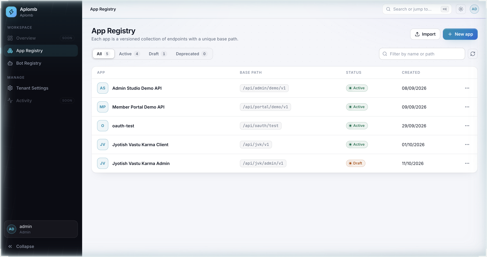
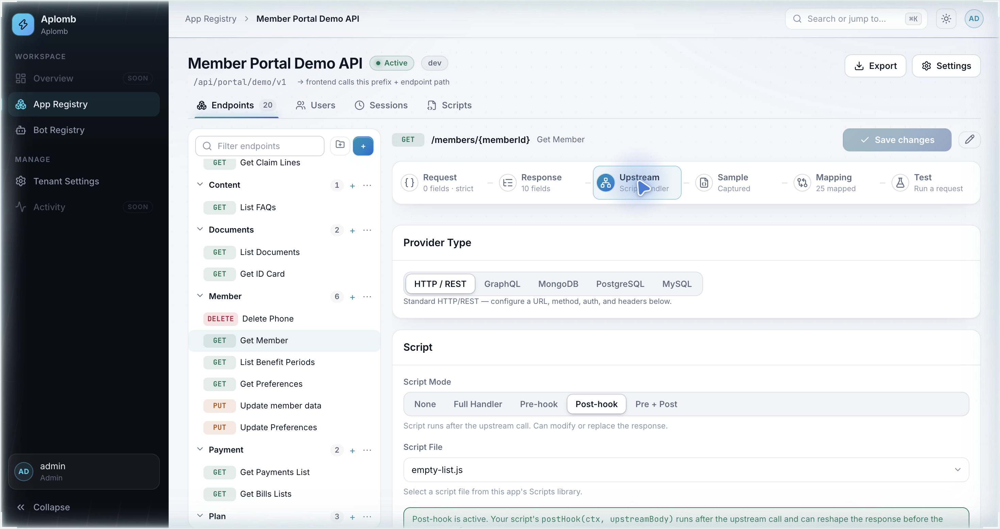
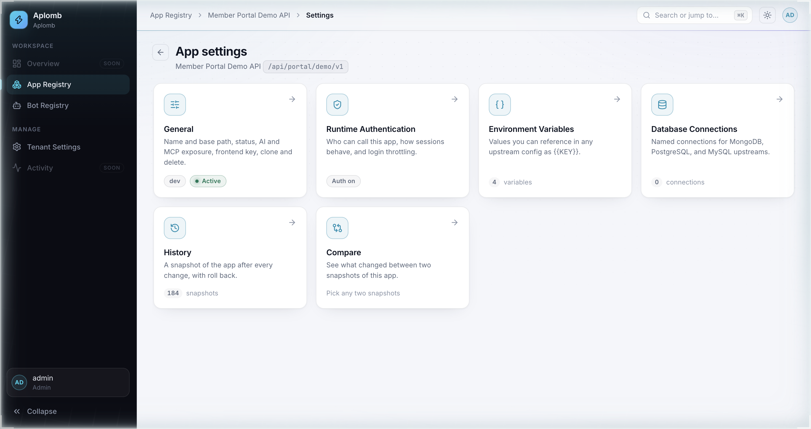
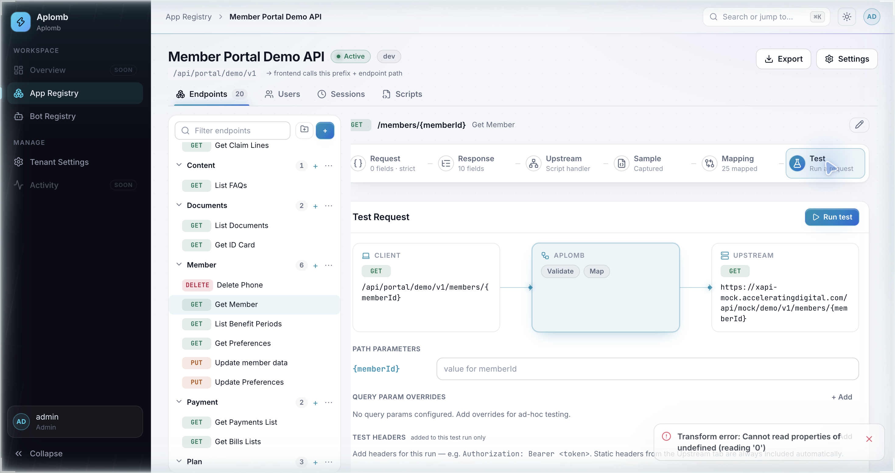
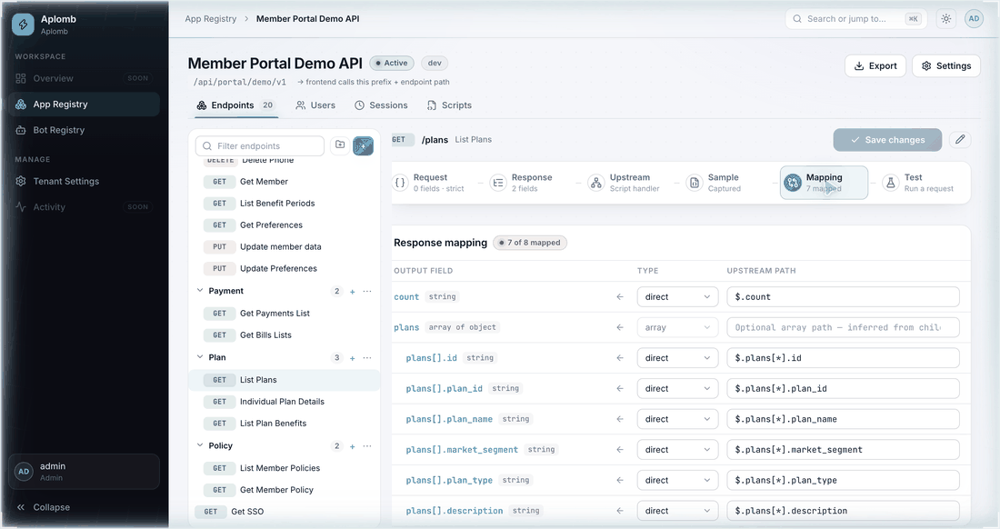
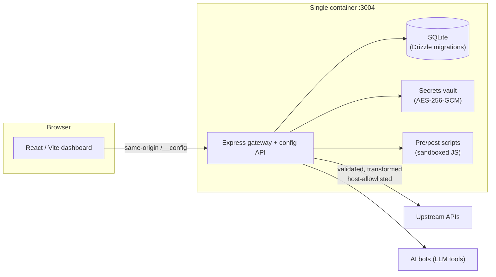

# Explore Aplomb

Aplomb is a self-hosted dashboard for configuring and publishing API endpoints — you register an app, define its endpoints (upstream, auth, request/response schemas, transformations, scripts), and every change is live on the gateway instantly, with no code deploy.

---

## Live demo & access

| | |
|---|---|
| **URL** | `http://localhost:3004` (unified single-container deploy) |
| **Login** | `admin` / `Admin@1234567890` |

> These credentials are for the local development instance only — they are seeded on first boot and should never be reused on an exposed deployment.

**What to try:**

1. Browse the **App Registry** — five sample apps, each with its own base path (`/api/portal/demo/v1`, …).
2. Open **Member Portal Demo API** → any endpoint → walk the configuration steps: Request → Response → Upstream → Mapping.
3. Open **Settings** on an app to see **Environment Variables** (`{{MOCK_SERVER_HOST}}`, `{{DEMO_ENDPOINT_PREFIX}}`…) that template into upstream URLs.
4. Open the **Test** step on an endpoint and run a live request — the response you see is exactly what a frontend would receive, after all transformations.

---

## Screenshots

### App overview



*The App Registry groups every published API into versioned apps, each with a unique base path and an Active / Draft / Deprecated lifecycle.*

### Endpoint configuration



*Each endpoint is configured in steps — this Upstream view shows the URL templated with environment variables, the forwarded auth mode, and how upstream form encodings are normalized.*

### Environments



*App-level environment variables can be referenced anywhere in an endpoint's config as `{{KEY}}`, so one config works across dev, staging, and prod hosts.*

### Test response



*The Test step fires a real request through the full pipeline — auth, validation, upstream call, mapping — and shows the final response exactly as a frontend would receive it.*

---

## How a change goes live

Editing config and running a request is all it takes — there is no build, no restart, no redeploy:

1. **Edit** — change any part of an endpoint (here: an output field's upstream path).
2. **Save** — the change is validated and versioned (the app keeps a snapshot after every change, with rollback).
3. **Live** — the very next request already flows through the new configuration.



*In this clip the `plan_name` field is re-pointed from `$.plans[*].plan_name` to `$.plans[*].plan_id`; the test response instantly shows the raw plan ID where the plan name used to be — then it is reverted the same way.*

> The demo viewer account is read-only, so the GIF is recorded from an admin session instead of a live editing walkthrough.

---

## Architecture



**Main technical decisions**

- **Single unified container** — one Node.js process serves both the dashboard SPA and the gateway on `:3004`; no split deployment to operate.
- **SQLite + Drizzle migrations** — zero-infrastructure persistence with 20 ordered migrations; the whole state is one file that is easy to back up.
- **Secrets encrypted at rest** — upstream credentials are AES-256-GCM encrypted with `SECRETS_ENCRYPTION_KEY` and never returned decrypted to the dashboard.
- **Host allowlist + SSRF guards** — upstream hosts must be explicitly allowlisted; private IP ranges are blocked.
- **Config-as-data pipeline** — endpoints are declarative records (schema → validate → upstream → map → script), so changes are versioned snapshots with one-click rollback instead of code.
- **Identity built in** — dashboard session auth with 2FA and OIDC (Google / Okta), plus per-app member portals with their own user stores.

---

## Run locally

```bash
git clone https://github.com/harshsharma-1804/api-orchestrator.git
cd api-orchestrator

# build and start the unified container (dashboard + gateway on :3004)
docker compose -f docker-compose.sqlite.yml up --build -d

# verify
curl http://localhost:3004/__health
# → {"status":"ok",...}
```

Then open `http://localhost:3004` and sign in with the bootstrap admin (below).

**Environment variables** (all have working dev defaults — see `api-orchestrator/.env.example`):

| Variable | Default | Purpose |
|---|---|---|
| `PORT` | `3002` | Internal server port (mapped to `3004` on the host) |
| `DB_PATH` | `/app/data/orchestrator.db` | SQLite file location (bind-mounted volume) |
| `SESSION_SECRET` | dev value | Session cookie signing secret — **change outside dev** |
| `SECRETS_ENCRYPTION_KEY` | 32 zeros | AES-256-GCM key for secrets at rest — **must be exactly 32 chars** |
| `BOOTSTRAP_ADMIN_USERNAME` / `_PASSWORD` | `admin` / `Admin@1234567890` | Seeded on first boot only, when no users exist |
| `UPSTREAM_HOST_ALLOWLIST` | `mock-server,localhost,host.docker.internal` | Comma-separated hosts the gateway may call |
| `ORG_NAME` / `ORG_SLUG` | `Default Organization` / `default` | Seeded organization (also carries the org-wide dashboard theme) |
| `AI_ENABLED` | `true` | Enables the AI bot layer |
| `ORCH_PUBLIC_BASE_URL` | derived per-request | Public base URL for IdP callback redirect URIs |

---

## Current limitations

Being candid about where Aplomb stands today:

- **Single-tenant only.** There is one organization per deployment. True multi-tenant hosting — per-tenant databases, isolated credentials, tenant-scoped domains and billing — is not implemented; the org record today only carries shared settings like the dashboard theme.
- **SQLite is a single writer.** Perfect for a self-hosted gateway, but it caps write throughput and rules out horizontal scaling. A Postgres backend would be the natural next step for clustered deployments.
- **No built-in edge concerns.** TLS termination, per-client rate limiting, and WAF-style protections are assumed to live in front (reverse proxy / ingress), not inside Aplomb.
- **No hosted demo.** The "live" instance is your local container — nothing is publicly reachable yet.
- **Viewer accounts can't demo editing.** Read-only users see everything but cannot change config, so the edit-to-live story is shown via a recorded GIF rather than live clicks.
- **Snapshot retention is manual.** Version history is comprehensive (every change is a snapshot with rollback), but there is no automatic pruning policy yet.

---

*Aplomb — configure the API, publish it live, skip the deploy.*
